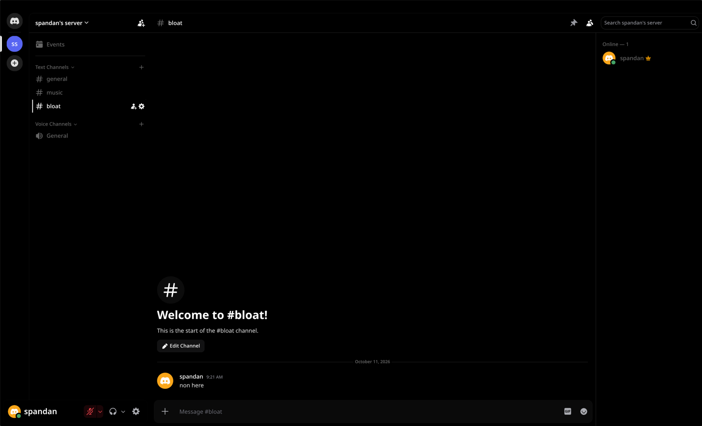
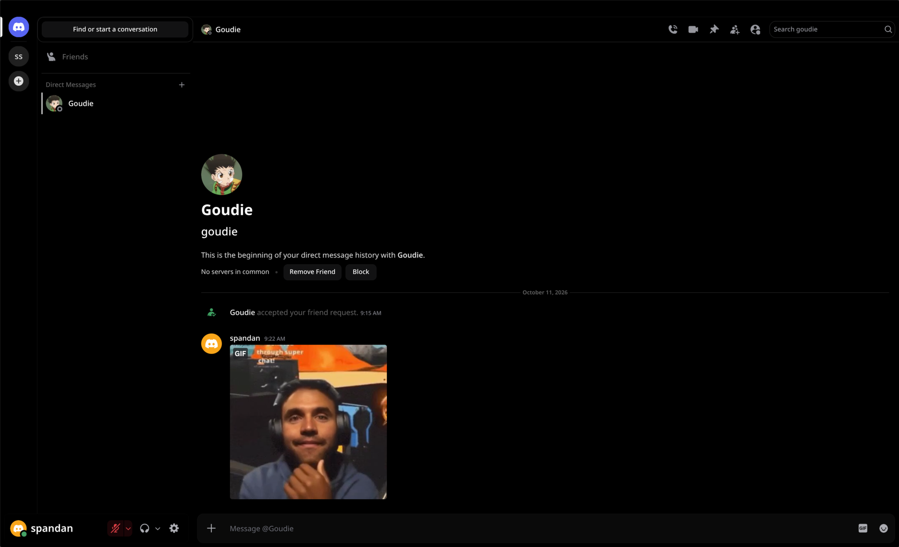
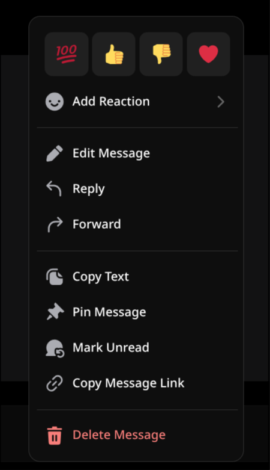
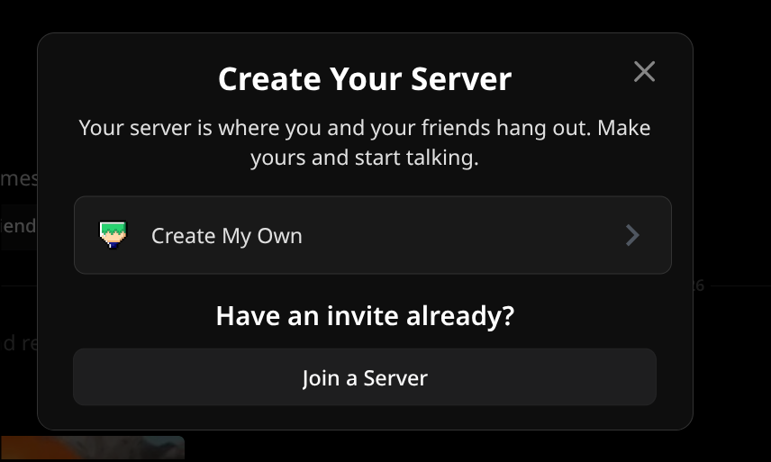

# freedom

A minimal Discord theme: black, grey and rounded, with the clutter removed. It is a single CSS file for BetterDiscord, Vesktop, Vencord and any version of discord you may choose.



## What it changes

**Removed**

- Nitro, Shop, Quests, gift buttons, boost bars and other upsells.
- Sticker and app launcher buttons in the message box (upload, GIF and emoji stay).
- Threads, notification settings, inbox and help icons in the channel header (pinned messages, member list and search stay).
- Discover and Download Apps in the server list.
- The Active Now column on the home page.
- Game activity in profiles and the member list (Spotify stays).
- Clan tags and pronouns.
- Rarely used items in right-click menus: Create Thread, Bookmark, Create Reminder, Apps, Speak Message, Start a Call, Add Note and Ignore.
- Server templates in the Create a Server dialog (Create My Own stays).
- The top bar on Linux (see [Platform behaviour](#platform-behaviour)).

**Look**

- Black background, grey surfaces, white highlights. Discord's blurple becomes grey.
- Rounded menus, popouts, dialogs and message box; round server icons and folders.
- No shadows or glows; thin scrollbars; hover states fade in.
- The selected channel or DM is marked with a white bar instead of a filled background.
- Every profile is plain black: no profile theme colours, banners, badges, avatar decorations or profile effects.
- One font for every display name: no custom name fonts, gradients or glows.
- The user panel (bottom left) shows your avatar and a large name, without the status line.

## Screenshots

**dms n home**\
no nitro, no shop, no quests n no active now column, just your friends n your chats



**right-click menu**\
only the stuff you actually click, thread, bookmark, reminder, apps n speak message are gone



**create a server**\
no template list, its just Create My Own or join a server you already have an invite for



## Install

### Vencord, Vesktop and Equicord

Pick one of the two methods.

**Online theme (updates automatically)**

1. Open **Settings → Vencord → Themes → Online Themes**.
2. Add this URL:

   ```text
   https://raw.githubusercontent.com/SPANDANS04/freedom-theme/main/freedom.theme.css
   ```

**Local file**

1. Download [`freedom.theme.css`](freedom.theme.css).
2. Open **Settings → Vencord → Themes** and select **Open Themes Folder**.
3. Move the file into that folder.
4. Turn on **freedom** in the theme list.

### BetterDiscord

1. Download [`freedom.theme.css`](freedom.theme.css).
2. Open **Settings → BetterDiscord → Themes** and select **Open Themes Folder**.
3. Move the file into that folder and turn on **freedom**.

## Settings

Change settings by adding a `:root` block to your client's custom CSS (in Vencord: **Settings → Vencord → Themes → Edit QuickCSS**; in BetterDiscord: **Settings → BetterDiscord → Custom CSS**). Your values override the theme's defaults.

Example: paint every role pink.

```css
:root {
	--freedom-role-mode: custom;
	--freedom-role-color: #eba4e6;
}
```

### Role colours

| Variable | Default | Values |
| --- | --- | --- |
| `--freedom-role-mode` | `real` | `real` keeps each server's role colours. `custom` replaces every role colour with `--freedom-role-color`. |
| `--freedom-role-color` | `#ffffff` | Any CSS colour. Used only when `--freedom-role-mode` is `custom`. |

Custom role colours use CSS style queries. Browsers without style query support ignore the setting and show real role colours.

### Palette

| Variable | Default | Used for |
| --- | --- | --- |
| `--freedom-bg` | `#000000` | App background |
| `--freedom-input` | `#0a0a0a` | Message box and search field |
| `--freedom-panel` | `#0e0e0e` | Menus, popouts, dialogs |
| `--freedom-card` | `#181818` | Cards, voice channel users |
| `--freedom-hover` | `#202020` | Hover background |
| `--freedom-button` | `#2a2a2a` | Buttons, selected items, mentions |
| `--freedom-button-hover` | `#363636` | Button hover |
| `--freedom-border` | `#333333` | Borders and dividers |
| `--freedom-fg` | `#e0e0e0` | Body text |
| `--freedom-dim` | `#666666` | Secondary text and icons |
| `--freedom-dimmer` | `#444444` | Muted channels and icons |
| `--freedom-accent` | `#ffffff` | Headings, links, selection marker |
| `--freedom-warn` | `#ff6b6b` | Errors and destructive actions |

## Platform behaviour

- **Top bar.** On Linux, freedom hides Discord's top bar (back and forward buttons, title, inbox) and leaves a 16 px gap, because the window manager draws the window frame. On Windows and macOS the bar stays, so the minimise, maximise and close buttons remain. The bar also stays on any system where it contains window buttons.
- **Fonts.** Text uses Noto Sans and code uses JetBrains Mono when they are installed. Otherwise freedom falls back to Discord's own fonts.

## When something looks wrong

Discord changes its class names with most updates, so some rules stop matching from time to time. To report a broken element:

1. Open developer tools with `Ctrl+Shift+I` (`Cmd+Option+I` on macOS). In Vesktop and some clients you must enable developer tools in settings first.
2. Right-click the element and select **Inspect**.
3. [Open an issue](https://github.com/SPANDANS04/freedom-theme/issues) with a screenshot of the element and of the highlighted line in developer tools.

## Licence

[MIT](LICENSE)
